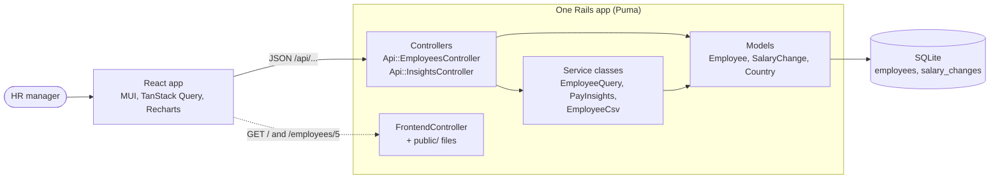
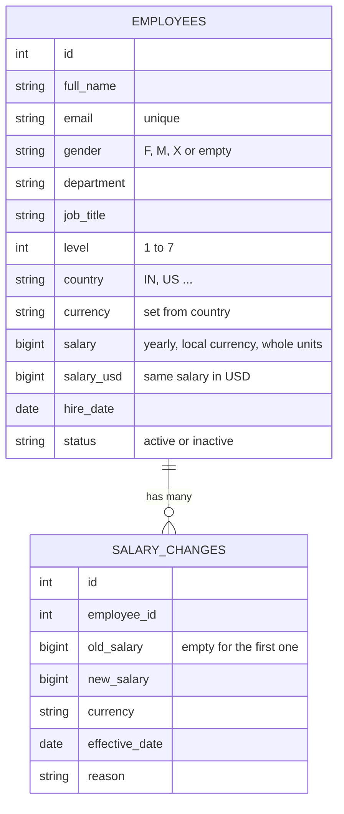
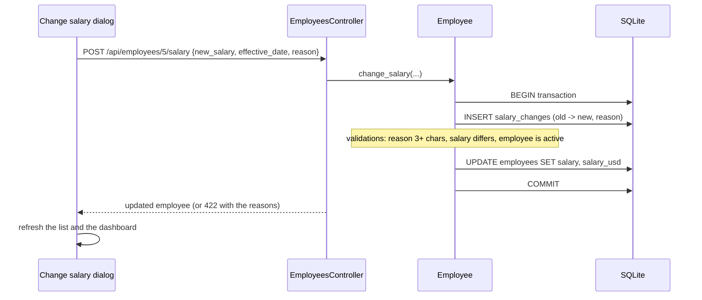

# How the system works

This page explains the parts, why they are built this way, and what would change as the app grows.

## 1. The big picture

- **One server.** Rails answers `/api/...` with JSON and every other URL with the built React app (`public/index.html`). Nothing else to run or host.
- **Standard Rails MVC.** Models hold the rules, controllers are thin, and three small "service" classes hold logic that does not belong to one model.

## 2. Database

Choices and reasons:

| Choice | Reason |
|---|---|
| Salary is a **whole number** | No float rounding errors with money. |
| `salary_usd` is **stored**, not calculated each time | Lets the database filter and sort by USD with a normal index. It is set in a `before_save` callback, so it can not be forgotten. If exchange rates change, run a one-line update (rates are fixed and dated for now). |
| Currency comes from the **country** on the server | A US employee can never be saved with INR. |
| `salary_changes` is **only added to**, never edited | It is the audit trail. |
| `status` instead of deleting people | History and reports must survive when someone leaves. |
| Indexes on country, department, level, status, salary_usd, full_name | These are the columns the screens filter and sort by. |

## 3. What happens when HR changes a salary

If any step fails, nothing is saved, so the history and the employee can never disagree.

## 4. The pieces, in simple words

| File | Job |
|---|---|
| `app/models/employee.rb` | Validations, cleaning (`normalizes`), currency and USD salary, first history row, `change_salary` |
| `app/models/salary_change.rb` | One history row and its rules (reason needed, salary must differ, employee must be active) |
| `app/models/country.rb` | The 12 countries, their currency and fixed USD rate |
| `app/services/employee_query.rb` | Turns the URL filters into one database query (search, filters, sort) |
| `app/services/pay_insights.rb` | Overview, breakdown, distribution and pay gap |
| `app/services/salary_stats.rb` | Median and percentiles |
| `app/services/employee_csv.rb` | CSV export and import |
| `app/services/employee_generator.rb` / `employee_seeder.rb` | Make and save the 10,000 fake employees |
| `app/controllers/api/*` | JSON endpoints; one error format |
| `app/controllers/frontend_controller.rb` | Sends the React app for non-API URLs |

## 5. Decisions and trade-offs

| Decision | Instead of | Why |
|---|---|---|
| **SQLite** | PostgreSQL | The brief suggests it, there is nothing to install, and 10,000 rows is small. Switching to PostgreSQL later is a change in `config/database.yml` plus the `pg` gem. |
| Insights are calculated in **Ruby** from one small query | Complex SQL | Median and percentiles are awkward in SQL. The Ruby version is easy to read and test with hand-made rows. It takes about 50 ms for 9,500 rows. For millions of rows, use SQL grouping or a summary table. |
| `limit/offset` paging | Cursor paging | The screen needs "page 3 of 400" and any sort order. Fine at this size. |
| Salary change is **its own endpoint** | Editing the salary field | Forces a reason and date, and always writes history. `PATCH` ignores `salary` and `country`. |
| Country can not change | Allow editing | A new country means a new currency, so the old salary number would be wrong. |
| Filters and sort live in the **URL** | Component state | A filtered view can be shared and survives a refresh. |
| Fixed exchange rates | Live rates | Same numbers every time, no outside service. The UI shows the date. |
| Pay gap needs **5 people per gender** | Always show | A median of 2 people is noise and can mislead. |
| No login | Devise / JWT | Out of scope for one user type (see requirements). |
| No Sidekiq / Redis | Background jobs | Nothing here is slow. Import of 20,000 rows is the largest job and runs in one request. |

## 6. Speed (10,000 employees, local, development mode)

| Request | Rails time |
|---|---|
| Employee list (filter, sort, 25 rows) | about 12 ms |
| Insights (load about 9,500 rows and calculate) | about 50 ms |
| Seed 10,000 employees + about 25,000 history rows | about 2 seconds (`insert_all` in batches of 1,000) |

How: database indexes, `insert_all`, one query per request, no N+1 queries (the list loads employees only), and the React app keeps the previous page on screen while the next one loads.

## 7. Security

- **Strong parameters**: each action lists exactly which fields it accepts.
- **SQL injection**: values are bound by ActiveRecord; the sort column comes from a fixed list (a spec tries `sort_by=salary; DROP TABLE employees`); `%` and `_` in search text are escaped.
- **CSV formula injection**: exported text starting with `=`, `+`, `-` or `@` gets a leading `'`.
- **Limits**: page size max 100, import max 20,000 rows, only the first 100 import errors are returned.
- **Not included**: login/roles/2FA, rate limiting, and an audit log of *who* made a change (needs users).

## 8. Tests

- **RSpec**, about 80 examples, a few seconds. Each example runs inside a database transaction that is rolled back, so tests never affect each other.
- **Model specs**: validations, cleaning, USD salary, first history row, `change_salary`.
- **Service specs**: statistics, insights (hand-made rows), generator (same seed = same data).
- **Request specs**: every endpoint (status codes, JSON, errors, filters, paging, injection attempts, CSV).
- **React tests (Vitest)**: formatters, debounce, API client, salary dialog.
- GitHub Actions runs both on every push.

## 9. What I would do next

1. Login with roles (HR admin / read-only) and 2FA, and save *who* changed each salary.
2. PostgreSQL and a persistent disk for the live site.
3. Salary bands per level and country, and a flag for people outside the band.
4. Bulk raise (for example +4% for a department) with a preview.
5. Bonus and equity in a separate table.
